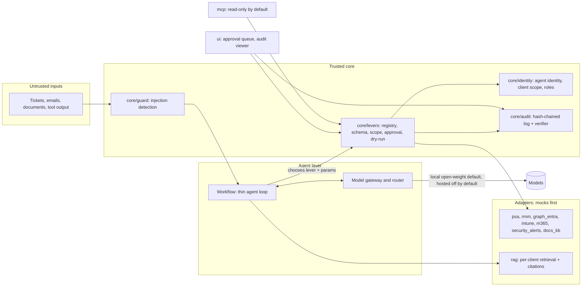
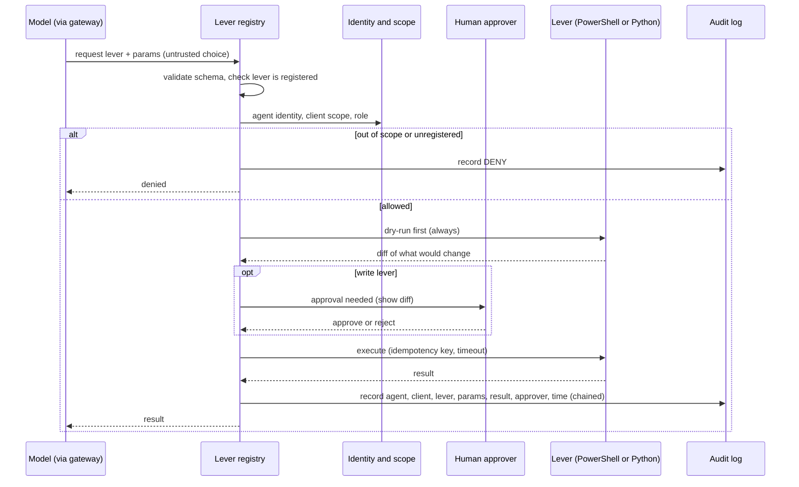

# Architecture

Status: **built** for the core, the levers, the approval page and the workflows, on mock adapters and synthetic data; **document-only** for `infra/` and `governance/`. The diagrams below are the design the code follows. Per-module status is recomputed from the files by `tools/coverage_audit.py` (`docs/COVERAGE_AUDIT.md`); older, hand-kept rows are in `docs/COVERAGE.md`.

## Principle
Agents are button-pushers. Deterministic, tested **levers** do the work. A model only picks a lever and fills validated parameters. Permissions, approval and audit are enforced in the lever layer, in code.

## System overview

## One lever call

## Modules
Status words: **Real** = code with a passing test (it still acts on mocks); **Mock** = runs on fixtures or fakes only; **Document-only** = written, nothing executable or nothing run against a real environment.

| Module | Purpose | Status |
|--------|---------|--------|
| core/gateway | one model interface, router, providers (mock default, loopback local model, hosted adapters off) | Mock |
| core/levers | registry, schema validation, scope, approval, pause, verification, dry-run engine, PowerShell bridge | Real |
| core/audit | append-only hash-chained log per client, head pin, verifier CLI | Real |
| core/identity, core/auth | identities, client scope, roles; approver sign-in checked against a mock issuer | Real, Mock (auth) |
| core/guard | untrusted-input wrapper and injection detector | Real |
| core/queue, ui | proposal queue and the local approval and audit page (127.0.0.1 only) | Real |
| levers/powershell, levers/python, levers/bash | the deterministic actions, run on mock state | Mock |
| adapters/* | interfaces and mocks of a PSA, Graph, backup, alerts, RMM, Intune and M365 | Mock |
| rag/ | per-client ingestion and retrieval with citations (in-memory) | Mock |
| prompts/ | versioned, hash-locked prompt library and standards | Real |
| mcp/ | stdio server exposing approved levers with scope enforcement | Mock |
| workflows/ | read-only or proposal-only sequences over fixtures, each with a README | Mock |
| evals/ | golden sets, scorers and fixture-based reports | Real code, mock data |
| infra/ | Bicep and pipeline source (never compiled, validated or deployed here) | Document-only |
| governance/ | policies, DLP mapping, SOC 2 control mapping, risk register, model and tool approvals | Document-only (with format checkers) |
| tools/ | coverage audit, packaged demo, roadmap exporter, change-fragment folder, schema and eval-gate helpers | Real |

## Design trade-offs
- Deterministic levers instead of a free-form agent: less flexible, much easier to test, approve and audit. New capability is a new lever with its tests.
- Permissions on the lever, not the model: a fooled model can only press buttons it was allowed to press, at the price of declaring every button in a registry.
- Mocks first: everything runs offline and fast, but nothing proves the real vendor behaves like the mock. Unchecked field names are listed in ``docs/UNVERIFIED.md``.
- One audit chain per client: a client's evidence can be exported alone, at the cost of no single global order across clients.
- Standard-library web page with no scripts: a small attack surface and no build step, at the cost of a plain interface.
## Build-time guardrails (exist now, Phase 0)
The repo is built under hooks that block risky tool calls and log every call to a hash-chained file. See `docs/THREAT_MODEL.md` section 3.
