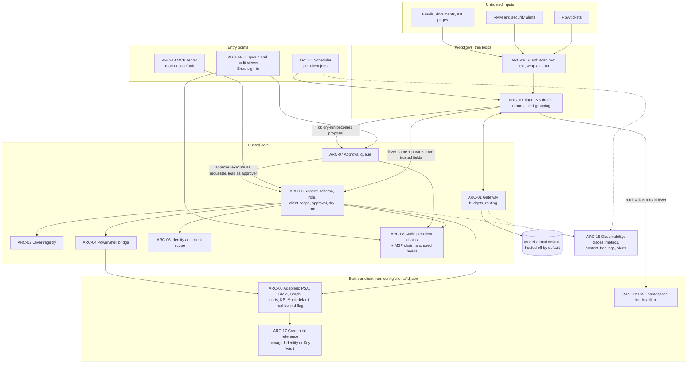

# Map 03: target architecture (50 to 500 client tenants)

Status: **document-only** (mapping stage, 2026-10-20). No code was written for this map. It describes where the current prototype is meant to go for a managed service provider with 50 to 500 client tenants, thousands of end users and many technicians, and what in today's code would have to change to get there. Rules referenced as `STD-...` are in `docs/STANDARDS.md`.

> Independently built prototype. Synthetic data only. Nothing here has run against a real tenant, PSA or RMM, and nothing is claimed as production.

Ids in this file: components `ARC-nn`, tenancy layers `TEN-nn`, onboarding steps `ONB-nn`, scaling limits `SL-nn`, drift items `DR-nn`, open questions `OQ-nn`. They are stable; other documents may cite them.

---

## 1. Design in one paragraph

Agents stay button-pushers. Every action, at any scale, goes through one path: a workflow (or a scheduled job) asks the **lever runner** to dry-run a registered lever for **one client**; the runner checks registration, schema, role, client scope and approval in code, calls the lever through an **adapter** that holds only that client's connection, and writes one **audit** record. Writes wait in the **approval queue** for a lead. Models are reached only through the **gateway**, see only wrapped untrusted text for one client, and return text that rules turn into at most one lever choice. Scaling to 500 tenants changes the storage and the scheduling under these pieces, not the path itself.

## 2. Components

Status words are the strict ones from `docs/COVERAGE.md`.

| Id | Component | Responsibility | Today | Target |
|----|-----------|----------------|-------|--------|
| ARC-01 | Model gateway (`core/gateway`) | One `complete(task, text)` interface; routes by config; returns `Completion`, never raises; text only | built (mock, loopback Ollama; hosted stubs off) | Adds per-client and global budgets (tokens, calls, cost), concurrency caps, a `model.complete` metadata audit event, and hosted adapters (Azure OpenAI first) behind config, off by default |
| ARC-02 | Lever registry (`core/levers/registry.py`, `levers/registry.json`) | Declares every lever and its permissions; fails closed | built (4 levers) | Same file format plus the STD-LV-10 fields (`runtime`, `entry`, `lever_version`, `graph_scopes`, `adapter`, `undo`, `reversibility`, `verification`; `risk_class` and `impact` required on write levers from `B-01`); split into one file per domain if it grows past about 100 levers, merged at load |
| ARC-03 | Lever runner, Python (`core/levers/runner.py`) | All permission checks, dry-run diff, timeout, audit-then-apply | built | Unchanged order of checks. Execute lock becomes per client (SL-05); idempotency enforcement (STD-LV-6a); state comes from adapters, not a JSON file |
| ARC-04 | Lever runner, PowerShell bridge | Runs `runtime: "powershell"` levers in a child `pwsh` with one JSON request and one JSON result | planned | `core/levers/bridge.py` plus a tiny `Invoke-LeverRequest` entry script; process killed at `timeout_s`; `-WhatIf` for dry-run; schemas from `schemas/` (STD-LV-11, STD-XL) |
| ARC-05 | Adapters (`adapters/`) | Interfaces for PSA, RMM, Microsoft Graph (Entra, Intune, Exchange, SharePoint, Teams), security alerts, documentation/KB, Key Vault | mocked in place (`MockTenant`, Graph fixtures read by TenantBaseline) | One interface per system, a mock implementation for every interface (default), a real implementation behind a flag. Each adapter instance is built for exactly one client from that client's binding (ONB-03). Throttling handled in the adapter (429 and `Retry-After`) |
| ARC-06 | Identity (`core/identity`) | Actors, roles, client allow lists | built (synthetic file) | Humans from Microsoft Entra ID sign-in and group membership; agents as their own identities; client access by explicit list or by named client group (OQ-03) |
| ARC-07 | Approval queue (`core/queue`) | Pending write proposals, four-eyes decisions, approve-then-execute | built (JSONL file) | Database table with compare-and-set status changes (SL-02); views filtered to the clients a lead may decide; expiry of stale proposals |
| ARC-08 | Audit (`core/audit`) | Append-only hash chain, head pin, verifier | built (one JSONL file, one writer) | Per-client chains plus one MSP chain; heads anchored where the writer cannot rewrite them; scheduled verification with an alert (SL-01) |
| ARC-09 | Guard (`core/guard`) | Injection tripwire and untrusted-data wrapper | built (tripwire, fixture-based) | Same library, called by every workflow and by RAG ingestion; corpus grows in Phase 7 |
| ARC-10 | Workflows (`workflows/`) | Thin loops: triage, KB drafts, reports, alert grouping | built: triage (Slice A) | One folder each, each with evals; all call the runner, never an adapter directly |
| ARC-11 | Scheduler and orchestrator | Runs per-client jobs (baseline daily, access review quarterly, evidence bundle monthly, digests weekly) | planned | Job definitions in config; fan-out per client with caps per client and per adapter; durable job state and idempotent job keys (`job/client/period`); results become proposals or reports, never direct writes |
| ARC-12 | RAG (`rag/`) | Ingestion, per-client retrieval, citations, refusal | planned (Phase 5); `kb.search` is a keyword lever today | One index namespace per client plus one MSP-internal namespace; client filter applied in code from the caller's identity and lever call, never from the query text; leakage evals in CI |
| ARC-13 | Evals (`evals/`) | Golden sets, scorers, reports, thresholds | built: triage report, injection report | Per-workflow gates in CI; routing evals set model escalation thresholds; leakage and idempotency evals |
| ARC-14 | UI (`ui/`) | Approval queue and audit viewer | built (stdlib, loopback, demo sign-in) | Behind Entra ID sign-in; filtered by client scope; paging; same CSP and CSRF rules |
| ARC-15 | Observability | Traces, metrics, operational logs | planned | OpenTelemetry traces with a `request_id` carried into audit v2 records (STD-AU-2); per-client metrics labels; content-free JSON logs (STD-SC-8); alerts on audit verify failure, denial spikes, throttling, budget |
| ARC-16 | Config and client registry | Program config, lever registry, client records | built: `config/*.json`; client registry planned | `config/clients/<client-id>.json` per client (ONB-01), schema-validated, fail closed |
| ARC-17 | Secrets | Credentials for real adapters | planned | Managed identity first; Key Vault only where a credential cannot be avoided; Azure RBAC; nothing in the repo (STD-SC-5) |
| ARC-18 | MCP server (`mcp/`) | Exposes approved levers to other agents | planned (Phase 9) | A thin front over the runner: same checks, read-only by default, token audience validated, no token passthrough |

## 3. Diagram

## 4. Multi-tenancy at every layer

The rule (STD-ID-6): **one unit of work concerns one client**, and the client id is carried explicitly from the entry point to the storage path. Isolation is enforced in code at each layer below, so a mistake in one layer is caught by the next.

| Id | Layer | How isolation is enforced | Today | Proof |
|----|-------|---------------------------|-------|-------|
| TEN-01 | Identity | Each identity lists the clients it may act for; an unknown identity or client is a denial | built | P1-1 |
| TEN-02 | Lever runner | Identity scope and lever `client_scope` both checked before any handler or adapter runs; denial audited | built | P1-1, P1-4 |
| TEN-03 | Handler | Receives a deep copy of one client's state only; cannot name a path or another client | built | design of `MockTenant` + runner |
| TEN-04 | Adapter and credential | The adapter object is constructed for one client from its binding (tenant id, PSA company id, RMM site id, credential reference). A handler cannot pick a different binding. For Microsoft 365, the MSP's access to a client tenant is itself scoped by the client (GDAP: granular, time-bound, least-privileged access per customer that the customer must grant; [GDAP introduction](https://learn.microsoft.com/en-us/partner-center/customers/gdap-introduction), read 2026-10-20) | planned | new test: a lever for client A with an adapter built for B is refused at construction |
| TEN-05 | Storage paths | Client id is a validated slug and the only client-derived path segment; one resolver per store | built (`MockTenant.path_for`) | traversal test (exists for tenant ids) |
| TEN-06 | Gateway and prompts | A prompt carries one client's wrapped data; no cross-client context, cache or few-shot examples from another client; budgets counted per client | partly (triage sends one ticket) | planned leakage eval: canary strings from client B never appear in client A completions |
| TEN-07 | RAG | One namespace per client plus MSP-internal; the filter comes from the lever call's client, never from the query | planned | Phase 5 leakage evals (client A never sees client B) |
| TEN-08 | Queue and UI | A lead sees and decides only proposals for clients in their list; denial audited | built for decisions (four-eyes, scope); listing is not yet filtered (DR-12) | SC-1, new listing test |
| TEN-09 | Audit | Records carry the client id; target: one chain per client, so evidence for one client can be exported and verified without revealing another client's records | one shared chain | planned export-and-verify test |
| TEN-10 | Reports and exports | Each report is generated under one client and validated so every number reconciles to that client's source data | built for Slice B (summary reconciles) | SB-2 |
| TEN-11 | Observability | Client id is a label on metrics and traces; no content in logs; dashboards for one client show only that client | planned | log-content test (never-log list, STD-AU-4) |
| TEN-12 | Evals | Every component that reads client data has an isolation test (STD-TS-6) | built for runner | CI gate |

## 5. Onboarding with zero code changes where possible

### 5.1 A new client

| Step | Id | What changes | Code change? |
|------|----|--------------|--------------|
| Client record | ONB-01 | Add `config/clients/<client-id>.json` (proposed, `schemas/client.schema.json`): id, display name, industry tag (for example `dental`, `financial`), regulatory flags (for example HIPAA, GLBA Safeguards; set by the MSP, OQ-05), enabled levers (a subset of the registry), enabled jobs and their schedules, retention class | no |
| Identities | ONB-02 | Add the client id to the technicians' and leads' allow lists (or, target, to an Entra group mapped to the client, OQ-03) | no |
| Adapter binding | ONB-03 | In the client record: which adapter implementation per system (`mock` or real), the external ids (Entra tenant id, PSA company id, RMM site id) and a credential **reference** (managed identity or Key Vault secret name), never a value | no |
| Baseline thresholds | ONB-04 | Per-client overrides of baseline settings (stale days, maximum global admins, break-glass naming) in the client record; defaults from the module config | no |
| Lever scope | ONB-05 | A lever with an explicit `client_scope` list needs the client added (or the lever uses `"any"` and the client record's enabled-levers list is the gate) | no |
| Evidence and checks | ONB-06 | Run the baseline in dry-run, verify the audit chain for the new client, and check that the isolation test passes with the new id | no |
| Fixtures (this repo only) | ONB-07 | A synthetic tenant fixture and a `SOURCES.md` entry, if the client is to be demoed | no (data only) |

At 500 clients the client records are data, ideally generated from the PSA's company list by a read-only sync job that proposes new records for a human to approve (OQ-02).

### 5.2 A new lever

| Step | Id | What changes | Code change? |
|------|----|--------------|--------------|
| Registry entry | ONB-11 | Add the definition to `levers/registry.json` (all STD-LV fields) | no |
| Implementation | ONB-12 | PowerShell lever: a new function in an existing module, named in `entry`; the bridge runs it with no Python change. Python lever: a handler added to `HANDLERS` | yes, the lever itself (unavoidable), nothing in the core |
| Adapter method | ONB-13 | Only if the lever needs a call the adapter interface does not have yet; mock first | sometimes |
| Tests and doc | ONB-14 | Dry-run diff, idempotency, scope denial, audit, README (STD-DD-4) | tests only |
| Enable | ONB-15 | Add to clients' enabled-levers lists | no |

### 5.3 A new scheduled job or workflow

A job is config (`name`, `lever` or workflow, schedule, per-client enable, concurrency cap). A new workflow is code in `workflows/<name>/` that only calls the gateway, the guard and the runner (STD-LV-9), plus its eval set.

## 6. Scaling limits of the current design and the migration path

Rough sizes used below (assumptions, not measurements): 500 clients, 10,000 end users, 50 technicians, 2,000 tickets a day, a daily baseline per client, and every lever call audited. That is in the order of tens of thousands of audit records a day.

| Id | Limit today | Where | Why it breaks at scale | Migration path (smallest first) |
|----|-------------|-------|------------------------|--------------------------------|
| SL-01 | Single-writer audit log: one JSONL file, an in-process lock per path, head pin rewritten on every append, verifier reads the whole file | `core/audit/chain.py` (D-017) | Two processes (UI plus scheduler plus CLI) on one log would fork the chain; one shared chain mixes all clients' evidence; the head pin sits next to the log where the writer can rewrite both (THREAT_MODEL limit 4); full verification grows with the file | 1) **Per-client logs** (`audit/<client>.jsonl` plus `audit/_msp.jsonl`), same format, so each chain has fewer writers and each client's evidence exports alone. 2) A **cross-process file lock** around append (the queue's lock code already exists). 3) **Checkpoints**: every N records, write the head into the MSP chain, so verification can start from a checkpoint. 4) **Append-only store**: SQLite in WAL mode with triggers that refuse UPDATE and DELETE, then Postgres with an insert-only role; the hash chain stays as the tamper evidence. 5) **Anchor heads** off the writer's reach, for example in Azure Blob Storage with an immutability policy (UNVERIFIED for this design: not tested; see [immutable storage overview](https://learn.microsoft.com/en-us/azure/storage/blobs/immutable-storage-overview), not re-read today) |
| SL-02 | JSONL queue: every operation re-reads the whole file; one lock file for all clients | `core/queue/store.py` | Reads grow with history; all leads across all clients contend on one lock; listing is not filtered by scope | 1) Per-client queue files (same format). 2) SQLite table `proposals(id primary key, client, status, ...)` with status changes as `UPDATE ... WHERE id = ? AND status = 'pending'` (compare-and-set replaces the file lock), history in a separate append-only table. 3) Postgres when there is more than one host |
| SL-03 | File locks via `msvcrt.locking` / `fcntl.flock` | `core/queue/store.py` | Work on one machine only; not across hosts or containers; Windows locks one byte of a lock file | Replaced by database transactions (SL-02 step 2). Until then, documented as single-host |
| SL-04 | Mock tenant as one JSON file per client, load-modify-save | `core/levers/tenant.py` | Fine for mocks; real state lives in Graph, PSA and RMM | Replaced by adapters (ARC-05). The runner keeps the "copy, diff, then apply" idea by asking the adapter for the current state of the affected objects only, and each write lever's dry-run computes its diff from that |
| SL-05 | One global execute lock in the runner | `LeverRunner._execute_lock` | Serialises every execute for every client in one process | A lock per client (dictionary of locks keyed by client id), then per target object once adapters exist; idempotency keys guard against duplicates across processes (STD-LV-6a) |
| SL-06 | Timeout by daemon thread; a hung handler keeps running | `_run_with_timeout` | Hung threads accumulate in a long-running service | PowerShell levers run in a killable child process (ARC-04). Python levers that call networks use the adapter's own request timeouts so a hang cannot happen in practice; a watchdog counts leaked threads and alerts |
| SL-07 | Identity is a static file with explicit client lists | `config/identities.json` | 500 clients times many technicians is unmanageable by hand; no sign-in | Entra ID sign-in for humans; roles and client access from group membership; optional client groups (pods) (OQ-03). The `Identity` model stays the same; only the loader changes |
| SL-08 | Registry, identities and config load once at process start | loaders | A change needs a restart | Acceptable: config changes go through a PR and a deploy, which is the change-management record. No hot reload by design |
| SL-09 | No rate limits or budgets on model calls; no throttling handling | `core/gateway` | Cost and runaway loops; hosted provider quotas | Per-client and global budgets in config, a circuit breaker per provider, and a `model.complete` audit event (STD-AU-2) |
| SL-10 | No adapter throttling yet | future adapters | Microsoft Graph returns 429 with `Retry-After` when limits are exceeded, and common causes include many requests from one app across all tenants ([Graph throttling](https://learn.microsoft.com/en-us/graph/throttling), read 2026-10-20) | Adapter honours `Retry-After`, falls back to exponential backoff; scheduler caps concurrency per client and globally per app registration; prefer delta queries over full scans for daily jobs |
| SL-11 | UI is `http.server.HTTPServer` (one request at a time) | `ui/app.py` | Many leads at once would queue; no sign-in | Fine for the demo. Target: a small ASGI app (FastAPI is in the blueprint stack) behind Entra sign-in, same CSP and CSRF rules, server-side paging |
| SL-12 | Evals and reports run by hand | `evals/` | No regression gate per workflow beyond CI tests | CI gates per workflow (STD-TS-1 level 4) and a scheduled eval run on fresh synthetic sets |

## 7. Where things run (target, open)

The blueprint names Azure Functions, Logic Apps, Automation Accounts, Key Vault, managed identities and Log Analytics, deployed by Bicep through Azure DevOps (validate and what-if only in this repo). A plausible split, to be decided with the MSP (OQ-06):

- **Python core and workflows** as a container or Azure Functions app with a managed identity.
- **PowerShell levers** through the bridge in the same host, or as Automation Account runbooks invoked by the runner for clients whose credentials must stay in Azure Automation. The runner's checks and the audit stay in the core either way.
- **Scheduler** as timer-triggered functions (or Durable Functions for fan-out), with job state in the same database as the queue.
- **Audit and queue** in a managed Postgres or Azure SQL database with an insert-only role for audit, heads anchored to immutable storage.
- **Observability** to Log Analytics through OpenTelemetry.

None of this is deployed or tested here.

## 8. Drift: where current code departs from STANDARDS, and the smallest fix

Each row is small enough to be one pull request. None changes the behaviour a test currently proves, except where the row says so.

| Id | Standard | Where | What drifts | Smallest fix |
|----|----------|-------|-------------|--------------|
| DR-01 | STD-PR-5 | `workflows/triage/proposal.py` and `core/queue/store.py` | `proposal_id`, `Source` and the UTC helper are defined twice; triage builds proposals as dicts, the queue as a `Proposal` model | Triage imports `proposal_id`, `Source`, `Proposal.new` from `core.queue`; `make_proposal` becomes a thin wrapper or is removed; contract test unchanged |
| DR-02 | STD-AU-4 (6) | `core/levers/runner.py` `_record`, `handlers.user_reset_mfa` | The audit diff for `user.reset-mfa` contains removed authentication methods in full, including `phoneNumber` (synthetic `+1 555 0101` in the fixture), which redaction does not catch | Mask `before`/`after` values at known sensitive paths (`phoneNumber`, `emailAddress`, `displayName` of methods) in the audit copy of the diff only; the dry-run result shown to the technician keeps full detail. Add a test that no phone-shaped value reaches the log |
| DR-03 | STD-LV-6 | `core/levers/runner.py` | The idempotency key is computed and audited but never enforced; the crash path records no key | Pass `idempotency=idem` on the crash path now; enforcement (STD-LV-6a) as a separate Phase 7 change with its own tests |
| DR-04 | STD-AU-1, STD-AU-2 | `core/queue/store.py` `_audit`, `core/audit/chain.py` `Mode` | Queue decisions write `mode` `approve`/`reject`, while `Mode` in the audit module lists only `dry-run`/`execute` (the literal is not enforced, so it works) | Widen the `Mode` literal to the four values actually written and type `append(mode=...)` with it; the event split comes with audit v2 |
| DR-05 | STD-ID-5 | `levers/powershell/TenantBaseline/TenantBaseline.config.json` | Tenants are keyed `contoso` and `clean`; the rest of the repo uses `contoso-dental` and `fabrikam-capital` ("clean" is shown as Fabrikam Capital) | Add the canonical id as a field (`"clientId": "contoso-dental"`) and accept it as `-Tenant`; keep the old keys as aliases until the demo script is updated |
| DR-06 | STD-PY-3 | `pyproject.toml` `[tool.mypy] files = ["core"]` | `workflows`, `evals` and `ui` are not type-checked strictly | Add them to `files`; fix whatever mypy reports in the same PR |
| DR-07 | STD-CF-4 | `config/models.json`, `config/routing.json` | No `version` field (registry and identities have one) | Add `"version": 1` to both and to `GatewayConfig.load`'s checks |
| DR-08 | STD-CF-9, STD-PY-8 | `core/gateway/config.py` | `MODELS_FILE`/`ROUTING_FILE` are cwd-relative and need a `root` argument; other loaders use `Path(__file__).resolve().parents[2]` | A single `REPO_ROOT` in a new `core/paths.py`, used as the default `root`; other modules adopt it when touched |
| DR-09 | STD-PS-1 | `TenantBaseline.psd1` | `PowerShellVersion = '7.2'` | Raise to `'7.4'` when the first schema validation (`Test-Json -LiteralPath`) is added to the module |
| DR-10 | STD-LV-2 | `TenantBaseline.config.json` `fixLevers` | Names levers that are not registered: `user.require-mfa`, `ca.block-legacy-auth`, `role.remove-member` | Add a test that every fix lever named is either in `levers/registry.json` or in an explicit `planned` list; register them when Phase 3/4 builds them |
| DR-11 | STD-VR-3 | repo root | No `CHANGELOG.md` | Create it with an `Unreleased` section that lists Phase 1 and Slices A to C |
| DR-12 | TEN-08 | `core/queue/store.py` `list`, `ui/app.py` | Any signed-in demo identity can list every pending proposal for every client; deciding is scoped, listing is not | `list(status, viewer)` filters to the viewer's clients; the UI passes the signed-in identity |
| DR-13 | STD-PY-1, STD-DC-2 | `docs/BLUEPRINT.md` section 4, `specs/phase-1.md` "Language" | Say Python 3.11; the code requires 3.12 | One-line doc fix in both (BLUEPRINT is the owner's source document, so a note under it rather than an edit, if he prefers) |
| DR-14 | STD-PY-6 | `core/gateway/*.py`, `core/guard/wrap.py`, `core/guard/detect.py`, `core/guard/normalise.py`, `evals/injection/report.py`, `evals/triage/__init__.py`, and every `tests/phase1/test_*.py` | No `from __future__ import annotations` (the rest of `core` has it; the evals and test files were added to this row by the completeness pass) | Add the import when each file is next touched; no behaviour change |
| DR-15 | STD-PR-1, STD-PR-2 | `core/queue/__main__.py` `seed --demo` | Demo proposals are added without a prior audited dry-run (they are labelled demo seed data) | Run each seed through the runner as `triage-bot` dry-run first, or label the source `demo` in a widened `Source` literal |
| DR-16 | STD-XL-1 | repo | No `schemas/` folder; shapes are shared by convention (PowerShell `Finding` class, Python models) | Create `schemas/` with the generated `lever-registry`, `proposal`, `change` and `audit-record` schemas and the drift-check test; add `finding` by hand |
| DR-17 | STD-AU-2 | `core/gateway/gateway.py` | Model calls are not recorded anywhere | With audit v2, a `model.complete` metadata-only record per call (no prompt, no completion text) |
| DR-18 | STD-PS-9 | `tests/sliceb/Test-SliceB.ps1` | Plain-script tests, not Pester (allowed until Pester 5 is installed, D-002) | None now; migrate when the owner approves the Pester install |
| DR-19 | STD-PR (id) | `proposal_id` | SHA-256 over `lever + client + params` with no separator, so `"user.ab" + "c"` and `"user.a" + "bc"` hash the same input (needs two registered levers with such names; theoretical today) | In a versioned id (`P2-`), join with a NUL byte; keep `P-` ids readable. Not urgent |
| DR-20 | STD-DC-1 | `README.md`, `CONTRIBUTING.md`, `SECURITY.md`, `docs/BLUEPRINT.md`, `docs/COVERAGE.md`, `docs/DECISIONS.md`, `docs/DEMO.md`, `docs/ENVIRONMENT.md`, `docs/RUNBOOKS.md`, `evals/triage/report.md`, `fixtures/graph/SOURCES.md`, `specs/*.md` | The rule says every doc starts with a strict status word; only the map documents and `docs/planned/*` do. Several use free words ("Status: complete", "Status: spec written") or none | Add a `Status: **<word>**` second line to each doc that is not a template; extend `map/check_map.py`'s status check to `docs/*.md` once they pass. `docs/BLUEPRINT.md` is the owner's document, so ask first |
| DR-21 | STD-DC-7, STD-PS-2 | `workflows/triage/`, `levers/powershell/TenantBaseline/`, the four Python levers in `core/levers/handlers.py` | No README beside the workflow or the module (purpose, inputs, outputs, permissions and scopes, dry-run example, eval result, known limits); the PowerShell test script sits at the module root instead of `tests/` | One README per workflow and module, written from what `docs/RUNBOOKS.md` and `docs/DEMO.md` already say; the Python levers get theirs when `B-14` moves them to `levers/python/`. Moving the test script waits for Pester (DR-18) |
| DR-22 | STD-FX-3, STD-ID-5 | `fixtures/graph/contoso/`, `fixtures/graph/clean/` (10 files) | The Graph-shaped fixtures carry no `_note`, and the folder names are not canonical client ids. STD-FX-3 conflicts with STD-CF-6 (mirror the vendor shape exactly) for these files | Decide the rule for vendor-shaped files (a sibling `SOURCES.md` entry counts as the label, recorded as a DECISIONS entry naming STD-FX-3); rename the folders with DR-05 (`B-26`) |

## 9. What this map does not decide

Model choice per task (Phase 7 routing evals decide), the vector store (Phase 5), the hosting split (OQ-06) and the database product. Those are recorded as decisions when they are made.

## 10. Open questions only the owner or the MSP can answer

| Id | Question | Who | Why it matters |
|----|----------|-----|----------------|
| OQ-01 | Which PSA, RMM and documentation platforms does the MSP run, and is API access for an automation identity allowed? **Decided: see 06-decisions.md D6-01.** | The MSP | Decides the first real adapters (ARC-05) and their shapes; nothing is assumed today |
| OQ-02 | Is the PSA's company list the source of truth for client ids, and who approves a new client record? **Decided: see 06-decisions.md D6-15.** | The MSP | ONB-01 at 500 clients |
| OQ-03 | How are technicians mapped to clients today (everyone sees everyone, teams or pods, named accounts)? Are there Entra groups for it? **Decided: see 06-decisions.md D6-14.** | The MSP | TEN-01, SL-07: explicit lists or client groups |
| OQ-04 | How does the MSP reach client Microsoft 365 tenants: GDAP relationships, per-client app registrations, or both? Which roles? **Decided: see 06-decisions.md D6-09.** | The MSP | TEN-04, STD-SC-4; least-privilege scopes per lever |
| OQ-05 | Which clients carry which obligations (HIPAA for dental, the FTC Safeguards Rule or other rules for financial firms, contract terms on AI), and who sets the per-client regulatory flags? **Decided: see 06-decisions.md D6-12.** | The MSP (and their counsel) | Client records, never-log list, retention, what may enter a prompt; this repo does not interpret law |
| OQ-06 | Where should this run: the MSP's Azure tenant (Functions, Automation Accounts) or on-premises; is Azure OpenAI or another hosted model approved for client data? **Decided: see 06-decisions.md D6-11.** | The MSP | Section 7 hosting split; gateway defaults |
| OQ-07 | Audit evidence retention period and where SOC 2 evidence must live **Decided: see 06-decisions.md D6-16.** | The MSP | STD-AU-8, SL-01 anchoring and storage size |
| OQ-08 | Who is a "lead" for approvals (service desk lead, technical services manager, account owner)? Governance HO-3 proposes two approvers for R3 levers (same question as ROADMAP RQ-06). **Decided: see 06-decisions.md D6-05.** | The MSP | STD-LV-4, ARC-07 |
| OQ-09 | One Key Vault per client or per environment for the credentials the automation needs? **Decided: see 06-decisions.md D6-10.** | The MSP | STD-SC-5, ARC-17 |
| OQ-10 | PowerShell function prefix for public lever functions (none, or a short prefix that does not imply any affiliation) **Decided: see 06-decisions.md D6-30.** | The owner | STD-PS-2 naming; avoids later renames |
| OQ-11 | Approve the Pester 5 and PSScriptAnalyzer installs (`docs/ENVIRONMENT.md`)? **the owner's call: see 06-decisions.md J-04** (recommendation there). | The owner | STD-PS-8, STD-PS-9, DR-18 |
| OQ-12 | Should drift fixes DR-01 to DR-22 be work items now, or wait until after the demo demo is frozen? **Decided: see 06-decisions.md D6-31.** | The owner | Avoids changing demoed behaviour (DR-02, DR-12 change visible output) |
