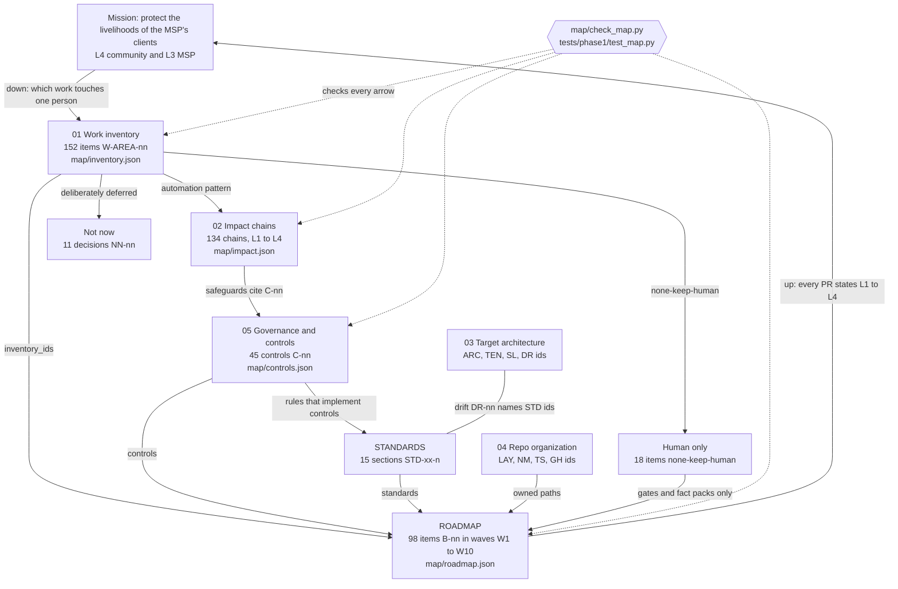

# Map index: from the mission to one person, and back

Status: **document-only** (mapping stage, 2026-10-20). No code was written for the maps; the one script in this stage, `map/check_map.py`, only reads them and checks that every cross-reference resolves. This is the master index for the five maps, `docs/STANDARDS.md` and `docs/ROADMAP.md`.

> Independently built prototype. Not affiliated with any vendor's or real company's systems. Synthetic data only: every person, practice and firm named in the maps is invented. Nothing here has run against a real tenant, PSA, RMM or backup system, and nothing is claimed as production. Volumes and scores are estimates and say so.

Ids in this file: index rules `MX-nn` (section 6) and synthesis fixes `SX-nn` (section 7). They are stable, and other documents may cite them.

---

## 1. The mission line

**The MSP protects the livelihoods of its clients. If we cannot save the individual, we will not change the tides globally.**

So every automation in this program is traced from the granular to the macro, and nothing is built that cannot show the trace:

| Level | Who | Example (synthetic) | Where the map holds it |
|---|---|---|---|
| L1 Individual | one person at one client, one ticket | Priya Nair, hygienist at Contoso Dental, phone lost, ticket T-3101 | `individual` in `map/impact.json`; IM-nn metrics in map 02 |
| L2 Client business | the practice or firm | Contoso Dental's 8:00 patient is seen on time; no PHI leaves the MSP | `business` in `map/impact.json`; data classes DC-n in map 05 |
| L3 MSP | The MSP, its technicians and leads | one hash-chained record for the SOC 2 auditor; minutes back per ticket | `msp` in `map/impact.json`; controls C-nn |
| L4 Community | patients, investors, the Denver-area small-business base | a social-engineering trick that cannot scale across 300 tenants | `macro` in `map/impact.json`; blast radius BR-n |

The same four levels are used in map 02 (chains), map 05 (governance, section 0), `STD-DD-10` (every PR states L1 to L4) and the W1 demo story.

## 2. How to read the map

Read it **down** first, from the mission to one person, then **back up**, from one change to the whole MSP:

1. **Down: what work exists.** `01-work-inventory.md` lists every unit of work in the job (152 items, `W-<AREA>-<nn>`), who does it today, how often, the risk class and the human-in-the-loop rule. 18 items are `none-keep-human`: they stay with people, and the roadmap only builds gates and fact packs around them.
2. **Down: who it touches.** `02-impact-chains.md` takes each of the 134 automatable items to one named synthetic person and traces it L1 to L4, with the harm of a false positive and a false negative, the blast radius and one individual metric. A chain has no separate id: **its id is the inventory id** (SX-04).
3. **Across: what keeps it safe.** `05-governance.md` and `map/controls.json` define the 45 controls (`C-nn`) each chain's safeguards cite, plus data classes, isolation rules, risk classes R0 to R3, oversight rules and the commitments owed to end users.
4. **Across: how it is built.** `docs/STANDARDS.md` holds the engineering rules (`STD-xx-n`) that implement the controls; `03-architecture-target.md` holds the target design for 50 to 500 tenants (`ARC-`, `TEN-`, `SL-`) and where today's code drifts from the standards (`DR-nn`); `04-repo-organization.md` says where every file lives and how GitHub is run.
5. **Up: when it is built.** `docs/ROADMAP.md` and `map/roadmap.json` turn all of it into 98 build items (`B-nn`) in 10 waves. Each item names the inventory ids it covers, the controls it needs, the standards it follows and the paths it owns, and its PR states who it helps at L1 to L4. That closes the loop back to the mission.

A worked trace, granular to macro and back (the W1 demo):

| Step | Id | What it says |
|---|---|---|
| Ticket | T-3101 (`fixtures/tickets/contoso-dental.json`) | Priya Nair's phone is in the lake; she cannot approve sign-ins |
| Work item | `W-IDM-02` MFA reset (lost or new phone) | exists today as the mocked `user.reset-mfa` lever; human verifies identity, lead approves the dry-run |
| Impact chain | `W-IDM-02` in `map/impact.json` | L1 back to work before the market or the first patient; the false positive is an impostor with a stolen phone (ticket T-3202) |
| Controls | `C-03`, `C-05`, `C-06`, `C-07`, `C-08` built; `C-30` planned; `C-33` partial | the agent can only dry-run; a scoped lead who is not the requester approves; the requester is verified out of band first |
| Standards | `STD-LV-4`, `STD-LV-10` (`risk_class`, `impact`, `verification`), `STD-AU-4` (no phone numbers in the audit) | the rules the W1 items must follow |
| Build items | `B-01` to `B-04`, `B-11` in `W1` | registry fields, runner gates, approval page, plain-language notice, the one-page leave-behind |
| Back up | `B-11`, `STD-DD-10` | the same ticket traced up to Contoso Dental, the MSP and the community |

## 3. How the pieces connect



## 4. The 10 highest-leverage automations

Leverage = B (benefit to one person) x N (people it matters for per month) x S (how well its worst failure is bounded), each scored 1 to 5; the method, the ties and every other item's score are in map 02, section 7 and Appendix A. Scores are judgment on estimated volumes, not measurements, and the MSP's real PSA data (IQ-01) would change them.

| Rank | Chain | Automation | Score | Risk (inventory) | In the repo today | Built in |
|---|---|---|---|---|---|---|
| 1 | [`W-BDR-01`](02-impact-chains.md#w-bdr-01-daily-backup-job-review) | Daily backup job review | 100 | R0 | not in the blueprint | `B-68`, [W3](../ROADMAP.md#w3-identity-lifecycle-one-persons-access) (moved from W6, D6-24) |
| 2 | [`W-PAT-05`](02-impact-chains.md#w-pat-05-emergency-patch-for-actively-exploited-vulnerabilities) | Emergency patch for actively exploited vulnerabilities | 100 | R2 | not in the blueprint | `B-47`, [W4](../ROADMAP.md#w4-security-monitoring-and-compliance-evidence) |
| 3 | [`W-SD-02`](02-impact-chains.md#w-sd-02-ticket-triage-category-priority-queue) | Ticket triage: category, priority, queue | 80 | R1 | exists (mocked) | `B-05`, `B-10`, [W1](../ROADMAP.md#w1-demo-story-one-person-end-to-end) |
| 4 | [`W-M365-11`](02-impact-chains.md#w-m365-11-tenant-security-baseline-and-drift-check) | Tenant security baseline and drift check | 80 | R0 | exists (mocked) | `B-10` (W1), `B-26` (W2), `B-50` (W4), `B-81` (W8) |
| 5 | [`W-SD-08`](02-impact-chains.md#w-sd-08-outage-and-widespread-issue-detection) | Outage and widespread-issue detection | 64 | R1 | planned | `B-23`, [W2](../ROADMAP.md#w2-platform-seams-and-service-desk-drafts) |
| 6 | [`W-KB-04`](02-impact-chains.md#w-kb-04-cited-question-answering-for-technicians-rag) | Cited question answering for technicians (RAG) | 64 | R0 | partial (keyword `kb.search`) | `B-56`, `B-57`, [W5](../ROADMAP.md#w5-knowledge-and-retrieval) |
| 7 | [`W-SEC-01`](02-impact-chains.md#w-sec-01-security-alert-intake-and-grouping) | Security alert intake and grouping | 64 | R0 | planned | `B-43`, [W4](../ROADMAP.md#w4-security-monitoring-and-compliance-evidence) |
| 8 | [`W-IDM-13`](02-impact-chains.md#w-idm-13-self-service-password-reset-and-mfa-method-coverage) | Self-service password reset and MFA method coverage | 60 | R0 | partial (MFA check in the baseline) | `B-40`, [W3](../ROADMAP.md#w3-identity-lifecycle-one-persons-access) |
| 9 | [`W-KB-06`](02-impact-chains.md#w-kb-06-authorized-contacts-and-escalation-lists-per-client) | Authorized contacts and escalation lists per client | 60 | R0 | planned | `B-34`, [W3](../ROADMAP.md#w3-identity-lifecycle-one-persons-access) |
| 10 | [`W-M365-03`](02-impact-chains.md#w-m365-03-mail-delivery-troubleshooting-message-trace) | Mail delivery troubleshooting (message trace) | 60 | R0 | not in the blueprint | `B-45`, [W4](../ROADMAP.md#w4-security-monitoring-and-compliance-evidence) |

What the list says: seven of the ten are read-only and none is R3, so the most leverage is in *seeing* problems early across every tenant. The two highest (backup review and exploited-flaw response) land in W3 and W4, after the demo story and the shared seams (ROADMAP section 1); `B-68` was pulled forward from W6 by D6-24. The chains with the highest stakes for one person (MFA and password resets, offboarding, business email compromise) are deliberately *not* on this list; map 02 section 7.3 names them and the control to build first for each.

## 5. Where each artefact lives

| Artefact | Human document | Machine twin | Ids it defines | Count |
|---|---|---|---|---|
| Work inventory | [`01-work-inventory.md`](01-work-inventory.md) | `map/inventory.json` | `W-<AREA>-<nn>` work items; areas SD, ONB, IDM, M365, EP, PAT, BDR, SEC, CMP, VND, RPT, KB, BIL, PRJ, TOOL, GOV, TRN | 152 items, 17 areas |
| Impact chains | [`02-impact-chains.md`](02-impact-chains.md) | `map/impact.json` | chains keyed by inventory id; personas `P-nn`; metrics `IM-nn`; blast radius `BR-n` | 134 chains |
| Target architecture | [`03-architecture-target.md`](03-architecture-target.md) | none | `ARC-nn`, `TEN-nn`, `ONB-nn` (client and lever onboarding steps), `SL-nn`, `DR-nn` | 18 components, 22 drift rows |
| Repo organization | [`04-repo-organization.md`](04-repo-organization.md) | none | `LAY-nn`, `M-nn`, `K-nn`, `NM-nn`, `TS-nn`, `GH-nn` | 2 moves, 8 kept in place |
| Governance and controls | [`05-governance.md`](05-governance.md) | `map/controls.json` | `C-nn`, `DC-n`, `ISO-n`, `BA-n`, `GLBA-n`, `AIR-n`, `HO-n`, `IR-n`, `CM-n`, `EU-n` | 45 controls: 22 built, 8 partial, 15 planned |
| Engineering standards | [`../STANDARDS.md`](../STANDARDS.md) | none | `STD-<area>-<n>`, `STD-DD-1` to `STD-DD-10` | 15 sections |
| Roadmap | [`../ROADMAP.md`](../ROADMAP.md) | `map/roadmap.json` | `B-nn`, `W1`-`W10`, steps `Wn-En` / `Wn-Xn`, acceptance `B<nn>-<k>`, `DOD-n`, `NN-nn`, findings `RF-nn` | 98 items, 10 waves, 11 not-now |
| Decisions on every open question | [`06-decisions.md`](06-decisions.md) | none | `D6-nn` decisions, `J-nn` the owner's calls | 32 decisions, 5 calls |
| The reference MSP profile | [`07-msp-profile.md`](07-msp-profile.md) | none | `MP-nn` profile rows, `AP-nn` adapter priorities | assumptions only, each row labelled ASSUMED or UNKNOWN |
| Map integrity check | this file, section 6 | `map/check_map.py`, `tests/phase1/test_map.py` | rules `MX-nn` | 9 rules |

"Built" in the controls count means real code with passing tests on synthetic fixtures; none has run against a real tenant.

**Question ids.** Each map keeps its own open questions, with its own prefix so none collide: `Q-nn` (01), `IQ-nn` (02), `OQ-nn` (03), `RO-nn` (04), `GQ-nn` (05), `RQ-nn` (ROADMAP), `MQ-nn` (this file). **As of 2026-10-21 every one of them is decided or routed to the owner in [`06-decisions.md`](06-decisions.md)**; each question row says which `D6-nn` or `J-nn` closes it.

## 6. Map integrity rules

`map/check_map.py` (standard library only, reads files, changes nothing) enforces these rules. `tests/phase1/test_map.py` imports it, so the Phase 1 suite and CI fail when a map drifts. Run it from the repo root:

```
uv run --frozen python map/check_map.py
```

It prints one `PROBLEM:` line per broken reference and a summary line, and exits 0 (clean), 1 (problems) or 2 (a map file is missing or not JSON).

| Id | Rule |
|---|---|
| MX-01 | Ids are unique and match their pattern (`W-<AREA>-<nn>`, `C-nn`, `B-nn`, `W<n>`, `NN-nn`); waves run W1 to W10 in order; patterns and risk classes use known values (B06-1). |
| MX-02 | Every inventory item with an automation pattern other than `none-keep-human` has exactly one impact chain; every chain points at a real inventory id; leverage ranks 1 to 10 are each used once. |
| MX-03 | Every control cited in `impact.json`, `roadmap.json` or a map document exists in `controls.json`, and a safeguard line that quotes a control uses its exact name and status. |
| MX-04 | Every roadmap item names real inventory ids, real control ids and real STANDARDS sections, and owns its own spec and change fragment (B06-2). |
| MX-05 | Every inventory id is covered by a roadmap item or a not-now entry (B06-3). |
| MX-06 | Dependencies resolve, point to the same or an earlier wave, and contain no cycle (B06-2). |
| MX-07 | No two items in one wave own the same path, or a path inside another item's folder (B06-4). |
| MX-08 | The Markdown twins list exactly the ids in the JSON: one section per inventory item in 01, per chain in 02, per build item in ROADMAP, and each ROADMAP `Owns` line equals the JSON. |
| MX-09 | Every `W-`, `B-`, `C-`, `STD-`, `ARC-`/`TEN-`/`SL-`/`DR-` and wave step id cited in a map document exists, and every map document opens with a strict status line (STD-DC-1). |

`B-06` (W1) keeps these passing and adds the Py suite runner and the inventory-versus-governance risk-class warning.

## 7. Fixes made in the synthesis pass (2026-10-20)

| Id | Where | What was inconsistent | Fix |
|---|---|---|---|
| SX-01 | 03 and 05 | Both used `OQ-` for open questions (`OQ-01`..`OQ-12` in 03, `OQ-1`..`OQ-13` in 05), so `OQ-11` meant both "Pester install" and "SOC 2 scope" | 05's questions renamed `GQ-01`..`GQ-13`; references in 02, 04, ROADMAP and `roadmap.json` updated |
| SX-02 | STANDARDS vs 05, 03, ROADMAP | STD-LV-3 said risk had no field of its own, while governance, ARC-02 and `B-01` add a required `risk_class` (plus `impact`, `verification`); STD-LV-4 did not have the R3 dual approval that HO-3 and `B-28` require | STD-LV-3, STD-LV-4 and the STD-LV-10 field table now carry `risk_class`, `impact`, `verification` and the R3 rule; ARC-02 and OQ-08 aligned |
| SX-03 | STANDARDS vs ROADMAP, 04 | `STD-DD-4`, `STD-DD-5`, `STD-DD-10` were cited but undefined (section 15 was an unnumbered list); `B<nn>-<k>` acceptance ids were not in STD-TS-2 | Section 15 items numbered `STD-DD-1` to `STD-DD-10`; STD-TS-2 and STD-DC-4 extended |
| SX-04 | 04, ROADMAP | Issue form and RF-02 expected `IC-nn` chain ids that no map defines | The chain id is the inventory id; 04 section 6.3, the issue form sketch, DOD-10 and RF-02 updated |
| SX-05 | 05, ROADMAP, `roadmap.json` | The W1 story and the governance trace named Ana Lopez as the person on ticket T-3101; the fixture's requester and affected user is Priya Nair (Ana Lopez is persona P-02, the office manager; `tech-ana` is the technician) | Renamed to Priya Nair everywhere; map 02 section 8 marked resolved |
| SX-06 | 01, 02, 05 | Status line not first (02, 05) or not a strict status word ("mapping only") | All map documents open with `Status: **document-only**` |
| SX-07 | 04, ROADMAP | `map/` layout omitted `impact.json`; `B-06` owned a future test file while the same checks now exist | Layout and LAY-16 updated; `B-06` owns `map/check_map.py` and `tests/phase1/test_map.py` |
| SX-08 | 04 vs 02 | Third synthetic client `litware-legal` (04, `B-21`) vs personas at "Woodgrove Legal" (02) | D-024 picked `litware-legal`; the map 02 personas and `map/impact.json` were renamed to Litware Legal on 2026-10-21 (D6-13) |

## 8. Open questions this index adds

Both are decided (see the rows). For the full decision set, read section 9.

The full lists stay in each map (section 5, question ids). Two only this view raises:

| Id | Question | Who |
|---|---|---|
| MQ-01 | The two highest-leverage chains (`W-BDR-01` backup review, `W-PAT-05` exploited-flaw response) are built in W6 and W4. Pull a read-only backup review (`B-68`) forward to W2 or W3, once backup is confirmed in scope (RQ-08, IQ-05)? **Decided: see 06-decisions.md D6-24.** | The owner, then the MSP |
| MQ-02 | Which risk-class rule wins for identity changes, R3 (01) or R2 (05)? Asked three times (IQ-06, RQ-01, and 02 section 8); one answer closes all three and sets `B-01`'s values. **Decided: see 06-decisions.md D6-07.** | The owner |

## 9. Decisions and the MSP profile (2026-10-21)

The owner delegated the open questions ("do research and decide for the MSP or bridge gaps"). [`06-decisions.md`](06-decisions.md) closes all 66 of them with 32 decisions (`D6-01` to `D6-32`), each with its basis, what would change it and the `B-` and `C-` ids it touches, and routes five that are the owner's own choices (`J-01` to `J-05`: publishing, `gh` commands, protected-file steps, installs, demo date) with a recommendation. [`07-msp-profile.md`](07-msp-profile.md) records what is publicly known about the MSP, each fact labelled CONFIRMED, INFERRED or UNKNOWN, and which adapters to build first. The repo-wide summary is `D-025` in `docs/DECISIONS.md`.

What changed in the roadmap: `B-89` (approver sign-in) moved W9 to W2 and `B-68` (backup review) W6 to W3; new acceptance on `B-18`, `B-21`, `B-28`, `B-30`, `B-42`, `B-43`, `B-52`, `B-55`, `B-61`, `B-62`, `B-65`, `B-68`, `B-74`, `B-85`, `B-90`, `B-91`. Governance 6.1 and HO-3 now match D-024 (identity changes are R3). The "Woodgrove Legal" personas in map 02 are now Litware Legal (closes SX-08).
